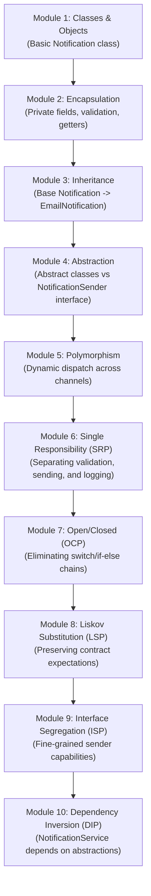

# Learning Roadmap: Java OOP & SOLID Principles by Example

Welcome to **Java OOP and SOLID Principles by Example**. This roadmap guides you step-by-step from core Object-Oriented Programming (OOP) fundamentals through the 5 SOLID design principles using a practical **Notification Management System**.

---

## 🗺️ Visual Architecture Evolution

---

## 📚 Milestone Breakdown

| Milestone | Module | Concept | Core Focus | Status |
|---|---|---|---|---|
| **Milestone 1** | **Module 1** | **Classes & Objects** | Blueprint vs instance, fields, methods, constructors, `new` keyword | **CURRENT** |
| Milestone 2 | Module 2 | Encapsulation | Private state, getters/setters, invariant validation, risk of public fields | Upcoming |
| Milestone 3 | Module 3 | Inheritance | `extends`, code reuse, method overriding, when inheritance fails | Upcoming |
| Milestone 4 | Module 4 | Abstraction | Abstract classes vs Interfaces, contract vs implementation | Upcoming |
| Milestone 5 | Module 5 | Polymorphism | Runtime dispatch, parent/interface references, flexible dispatch | Upcoming |
| Milestone 6 | Module 6 | SRP (Single Responsibility) | Cohesive classes; separating dispatch from validation and audit logging | Upcoming |
| Milestone 7 | Module 7 | OCP (Open/Closed) | Open for extension, closed for modification; eliminating `switch` on channels | Upcoming |
| Milestone 8 | Module 8 | LSP (Liskov Substitution) | Subtype contract guarantees; preventing unexpected exceptions/side-effects | Upcoming |
| Milestone 9 | Module 9 | ISP (Interface Segregation) | Avoiding fat interfaces; role-based interfaces (e.g., batch vs single send) | Upcoming |
| Milestone 10 | Module 10 | DIP (Dependency Inversion) | Inverting control; constructor injection, decoupled architecture | Upcoming |

---

## 🎯 How the Notification System Evolves

1. **Starting Point (Module 1)**: A simple `Notification` class with raw fields, constructors, and a `send()` method.
2. **Data Protection (Module 2)**: Encapsulating the data with private fields and validation (e.g., ensuring recipient and message are not blank).
3. **Hierarchy (Module 3)**: Modeling specific notification types (`EmailNotification`, `SmsNotification`) sharing common attributes.
4. **Contract Definition (Module 4)**: Introducing `NotificationSender` interface and abstract base classes.
5. **Runtime Flexibility (Module 5)**: Sending different notifications through uniform references.
6. **Separation of Concerns (Module 6)**: Extracting validation into a validator, logging into an audit logger, and keeping sending focused.
7. **Extensibility Without Edits (Module 7)**: Adding WhatsApp or Slack without editing existing service logic.
8. **Behavioral Integrity (Module 8)**: Ensuring all senders respect contract expectations without failing unexpectedly.
9. **Focused Contracts (Module 9)**: Segregating rich capabilities (like attachments or batching) from basic sending.
10. **Loose Coupling & Testability (Module 10)**: Wiring high-level services to abstractions using constructor dependency injection.

---

## 🚀 How to Study Each Module

1. Read the conceptual guide in `docs/`.
2. Inspect the source code under `src/main/java/com/example/notification/`.
3. Review and execute the unit tests under `src/test/java/com/example/notification/`.
4. Run the console application via `mvn compile exec:java`.
5. Discuss design trade-offs and interview questions before proceeding to the next milestone.
