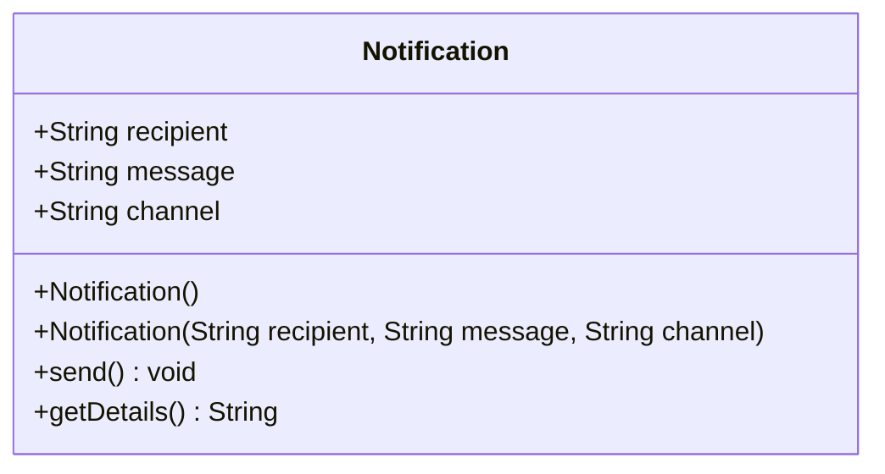

# Object-Oriented Programming (OOP) Concepts

This document details the core pillars of Object-Oriented Programming (OOP) in Java, explained progressively through our Notification Management System.

---

## Module 1: Classes and Objects

### 1. What Problem Are We Solving?
In procedural programming, data (e.g., recipient strings, message text) and the logic that operates on that data (e.g., printing or sending algorithms) are stored separately. As systems grow, this leads to disorganized code, accidental mutations, and maintenance nightmares.

Object-Oriented Programming solves this by bundling **state** (fields) and **behavior** (methods) together into a single cohesive unit called a **Class**.

---

### 2. Core Concepts Explained in Simple English

#### A. What is a Class?
A **Class** is a blueprint, template, or custom type. It does not hold real data on its own; it describes what properties and actions objects of that type will have.

*Analogy*: An architectural blueprint for a house is not a physical house. It defines where the walls, doors, and rooms will be.

#### B. What is an Object?
An **Object** is a concrete instance created from a class blueprint that physically lives in your computer's memory (the Java Heap).

*Analogy*: A physical house built in a neighborhood using the architectural blueprint. You can build 50 different houses from the same blueprint, each with its own paint color and address.

#### C. Fields (State)
Fields are variables declared inside a class. They define what an object *remembers* or *knows*.
- In [`Notification`](file:///Users/kshitijthakre/Development/Java/java-oop-solid/src/main/java/com/example/notification/model/Notification.java), fields are `recipient`, `message`, and `channel`.

#### D. Methods (Behavior)
Methods are functions declared inside a class. They define what an object *can do*.
- In [`Notification`](file:///Users/kshitijthakre/Development/Java/java-oop-solid/src/main/java/com/example/notification/model/Notification.java), methods are `send()` and `getDetails()`.

#### E. Constructors
A **Constructor** is a special block of code that runs automatically when a new object is created. Its primary purpose is to initialize the object's fields to a valid starting state.
- It has the exact same name as the class.
- It has no return type (not even `void`).
- Can be overloaded (e.g., a default no-argument constructor vs. a parameterized constructor).

#### F. Object Creation with `new`
When you write:
```java
Notification email = new Notification("user@example.com", "Hello!", "EMAIL");
```
Here is what the JVM actually does:
1. **`new` Operator**: Allocates memory on the Java Heap to store the fields of a new `Notification` instance.
2. **Constructor Call**: Invokes `Notification(...)` to populate those fields with the provided values.
3. **Reference Assignment**: Stores the memory address of the newly created heap object into the variable `email` on the Stack.

---

### 3. Visual Representation



```
STACK MEMORY                             HEAP MEMORY
+-----------------------------+          +---------------------------------------------+
| emailNotification           | -------->| Notification Instance @0x10A                |
| (reference: @0x10A)         |          | recipient: "student@example.com"            |
+-----------------------------+          | message:   "Welcome to Java OOP course!"    |
                                         | channel:   "EMAIL"                          |
+-----------------------------+          +---------------------------------------------+
| smsNotification             | -------->| Notification Instance @0x20B                |
| (reference: @0x20B)         |          | recipient: "+1-555-0199"                    |
+-----------------------------+          | message:   "Your verification code is..."   |
                                         | channel:   "SMS"                            |
                                         +---------------------------------------------+
```

---

### 4. Code Walkthrough

See the class [`Notification`](file:///Users/kshitijthakre/Development/Java/java-oop-solid/src/main/java/com/example/notification/model/Notification.java):

```java
public class Notification {
    public String recipient;
    public String message;
    public String channel;

    public Notification(String recipient, String message, String channel) {
        this.recipient = recipient;
        this.message = message;
        this.channel = channel;
    }

    public void send() {
        System.out.printf("[%s] Dispatching notification to '%s': %s%n",
                channel, recipient, message);
    }
}
```

#### What does each part do?
1. `this.recipient = recipient;`: The `this` keyword differentiates the instance field (`this.recipient`) from the constructor parameter (`recipient`).
2. `public void send()`: Reads the instance's state (`channel`, `recipient`, `message`) and executes the simulated dispatch logic.
3. Multiple instances created with `new Notification(...)` operate independently. Mutating the fields of one object does not alter any other instance.

---

### 5. Why Did We Design It This Way in Module 1?
In this foundational module, we deliberately left the fields `public` and did not add complex validation. Why?
- To clearly show the relationship between raw fields (state), methods (behavior), and memory allocation.
- To set the stage for **Module 2: Encapsulation**, where we show why public fields are dangerous and how encapsulating state protects application invariants.

---

### 6. Interview Questions & Answers

#### Q1: What is the difference between a class, an object, and a reference variable?
**Answer**:
- A **class** is a compile-time blueprint or metadata describing fields and methods.
- An **object** is a runtime instance allocated in heap memory containing real data values.
- A **reference variable** is a stack-allocated variable holding the memory address that points to the heap object.

#### Q2: What happens if you do not define any constructor in a Java class?
**Answer**:
If no constructors are explicitly declared, the Java compiler automatically provides a public, no-argument **default constructor** that initializes instance fields to their default values (`null` for references, `0` for numeric primitives, `false` for booleans). However, as soon as you define *any* constructor (e.g., a parameterized constructor), the compiler no longer generates the default constructor automatically.

#### Q3: What is the purpose of the `this` keyword?
**Answer**:
`this` is a reference to the current instance whose method or constructor is being invoked. It is commonly used to:
1. Resolve naming conflicts between instance variables and parameters (shadowing).
2. Invoke another constructor in the same class (`this(...)`).
3. Pass the current instance as an argument to another method.
